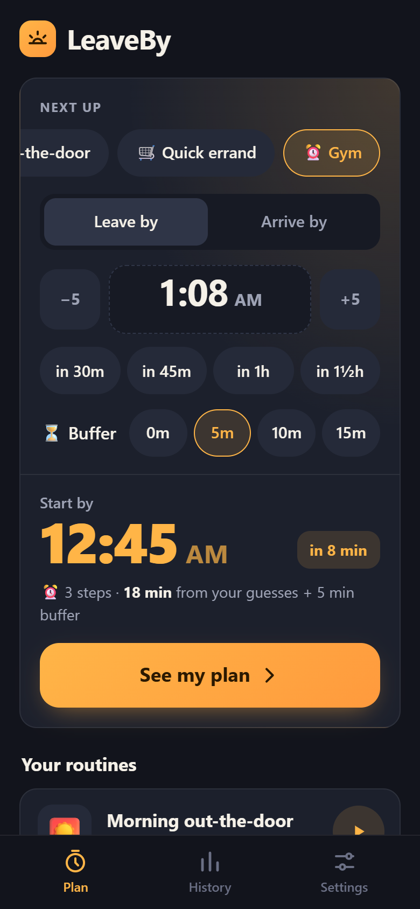
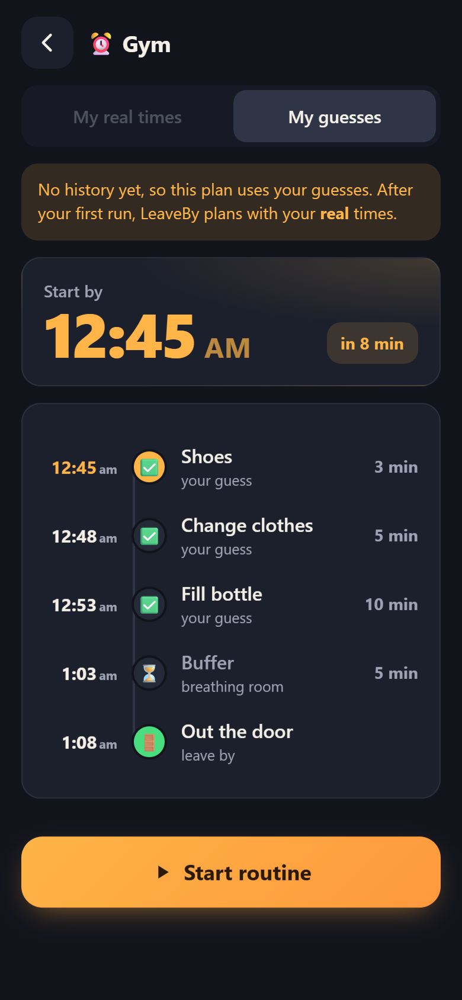
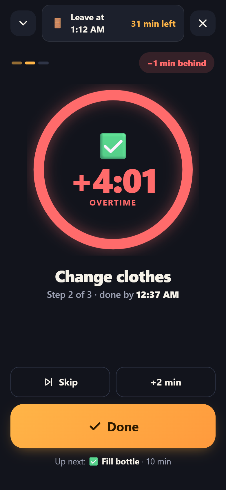
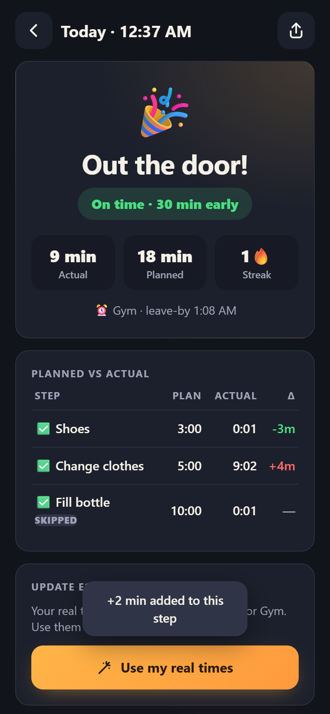
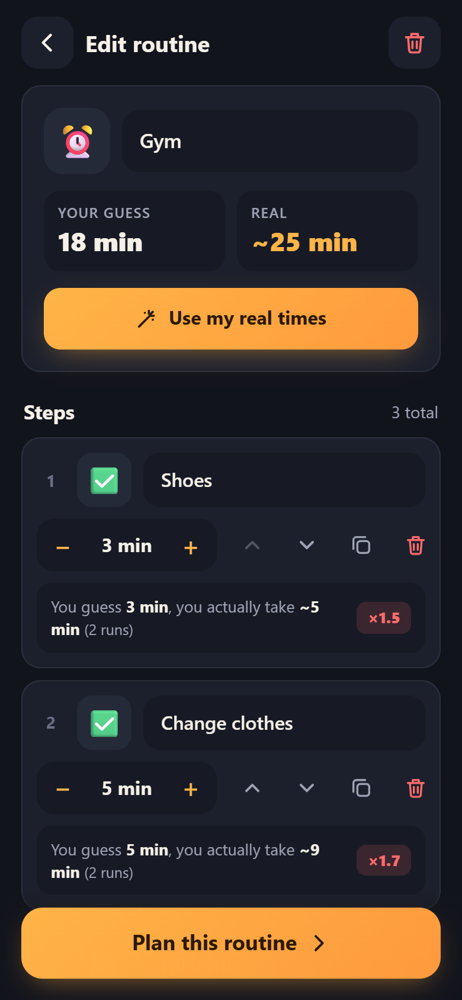
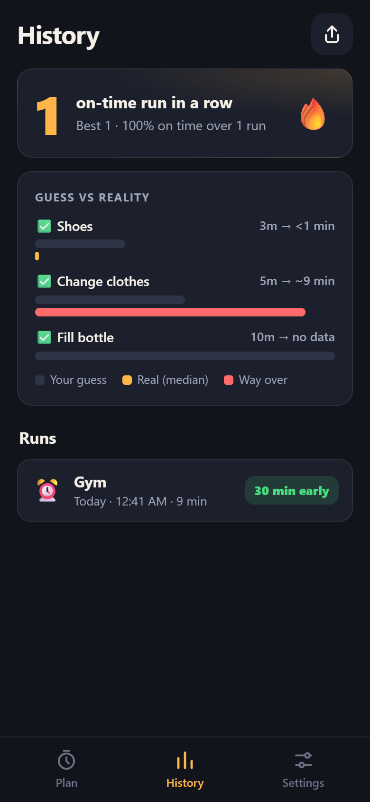

# LeaveBy

**Get out the door on time.** LeaveBy runs your routine step by step, learns how long each step really takes, and tells you exactly when to start.

## The problem

People with ADHD are often late because of *time blindness*. They underestimate how long getting ready takes, then find they're behind even though they "started with plenty of time". The usual advice is to time your real routine, keep a log, and plan backward from when you need to leave. Doing that by hand is tedious. ADHD task managers (Structured, TickTick) don't deal with lateness, and commute apps only cover the drive, not the 40 minutes before it.

Evidence:
- [TechCrunch: Lately's gamified app helps people arrive on time](https://techcrunch.com/2025/04/26/latelys-new-gamified-app-helps-people-arrive-on-time). Time blindness and poor time estimation are the biggest barriers. Existing ADHD apps don't address them, and Android's "Time to Leave" is outdated.
- [ADDitude: Time blindness & running late](https://www.additudemag.com/time-blindness-running-late-adhd/amp). Advice: measure how long routine tasks actually take.
- [Choosing Therapy: Time blindness](https://www.choosingtherapy.com/time-blindness/). Recommends "time trials" for tasks you underestimate, and planning backward from the deadline.
- [Mumsnet: ADHD daughter, time blindness and lateness](https://www.mumsnet.com/talk/parenting/5338437-adhd-daughter-time-blindness-and-lateness-need-help). A parent pieces together Alexa prompts for each stage of getting ready, and it "still isn't perfect".
- [Wondermind: ADHD hacks for time blindness](https://www.wondermind.com/?p=6009). Log how long activities take, add buffers, use visual timers.
- [Time blindness app guide](https://kick-mint.pages.dev/blog/time-blindness-app-guide). Working backward from arrival time is valued but rare, and usually behind a paywall.

## Features

- **Routine builder:** reusable routines of emoji-tagged, timed steps. Reorder, duplicate or delete steps. Comes with two starter routines ("Morning out-the-door", "Quick errand").
- **Backward planner:** choose *leave by* (or *arrive by* plus travel time) and a 0/5/10/15 min buffer to get a big **Start by** time, a live countdown, and a timeline with a clock time for every step.
- **Real times vs guesses:** plans use your *learned* durations by default. Flip a toggle to compare with your original guesses, e.g. "guesses say 7:35, reality says 7:12".
- **Live run mode:** full-screen current step with a shrinking progress ring that turns coral when you go over, an overtime counter, an ahead/behind chip (green +3 / red −4), and a "Leave at 8:05 · 23 min left" banner. Buttons for **Done**, **Skip** and **+2 min**, with vibration on step completion and on overtime.
- **Survives restarts:** the active run is saved on every action, and elapsed time is recalculated from timestamps, so reloading or killing the app doesn't lose your place.
- **Time-reality learning:** each step shows "You guess 5 min, you actually take ~11 min" (median of your last 7 runs) with a reality factor (×2.2). One tap on **Use my real times** updates your estimates.
- **Finish summary:** on time or late by X min, planned vs actual for each step, with skipped steps marked. Share the result.
- **History & streaks:** run log, on-time streak, and a guess-vs-reality bar chart for each step. Share a text summary.
- **Settings:** 12/24h clock, vibration on/off, default buffer, JSON export/import (copy/paste), reset.
- Works offline. No account, no ads, no network access.

## Screenshots

| Home | Plan | Run mode |
|---|---|---|
|  |  |  |

| Summary | Learned times | History |
|---|---|---|
|  |  |  |

## Install

Download `app-release.apk` from this repository's **GitHub Releases** page and open it on your Android phone. You may need to allow installs from unknown sources.

## Tech notes

- The app is vanilla HTML/CSS/JS in `app/src/main/assets/www/`, running inside a thin Android WebView shell (`MainActivity.java`). It uses no frameworks, CDNs or external fonts.
- All data lives in `localStorage` under the key `leaveby.v1` (routines, runs, active run, settings, last plan). Learned durations aren't stored: they're computed from run history as the median of the last 7 non-skipped actual times for each step.
- Native bridge features are detected before use: `Android.vibrate`, `Android.share`, `Android.toast`. The hardware back button goes through `window.onAndroidBack()`.
- End-to-end Playwright scenario covering the main flows: `_qa/scenario.js`.

Built autonomously by the Auto Builder agent swarm (Claude Code).
